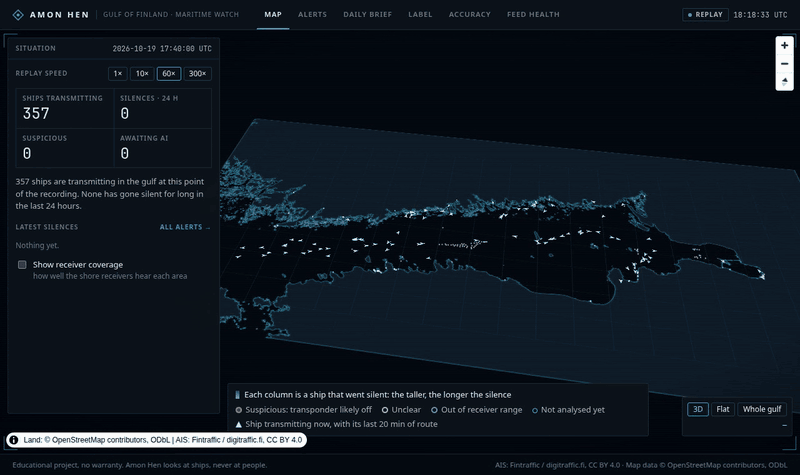
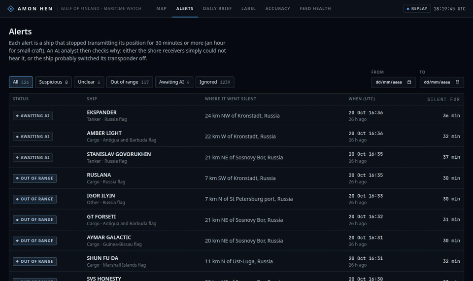

# Amon Hen

**An AI analyst that watches the Gulf of Finland for ships that go silent, and says, with evidence, whether each one fell out of receiver range or likely switched its transponder off.**



Ships broadcast their position over AIS. When one goes silent, the usual reason is mundane: the shore receivers could not hear it. Sometimes the transponder was switched off, which is what a ship does when it does not want to be followed. Amon Hen records the public AIS feed of the Gulf of Finland, detects the silences, and has an LLM agent investigate each one with tools over the recorded data. Every verdict comes with the evidence it rests on and the full trace of how the agent got there. The agent is then measured against a naive rule on cases labelled by hand, blind.

> **Status:** v1 in progress. The whole pipeline runs on real data. Whether its verdicts are right is not measured yet (see [Does it work?](#does-it-work)).
>
> Educational project, no warranty. Amon Hen looks at vessels, never at people: it uses only what the vessels broadcast and the open sources below.

*Amon Hen is the Hill of Sight in Tolkien, where whoever sat on its seat could see far across the land. The code, the specs and the roadmap still use the project's working name, Vigía.*

## See it work

Above, the map replays the real recording of 19 October 2026 at 300 times real speed. Ships move along the gulf with their last 20 minutes of route. Each column is a ship that went silent, taller the longer the silence, coloured by the AI analyst's verdict once it has one. Most of them gather at the Russian end, which the Finnish receivers hear worst.



One alert: **BALT FLOT 4**, a Russian-flagged tanker bound for Vysotsk, silent for an hour. Before the silence its track draws impossible circles, jumps that would need more than 50 knots: GNSS interference or spoofing, both common in this gulf. The analyst calls it *unclear*. Each piece of its evidence cites a step of the investigation, and clicking one opens that step: the tool it called, what it asked and what the tool answered. The model wrote the verdict, but the tools did the measuring.

## What the finished product will do

**v1, the version being finished:**

- **Watch the gulf 24/7.** A Raspberry Pi 5 records the public AIS feed around the clock and serves the panel.
- **Investigate every silence.** The investigations run on a free local model on a home GPU. Claude can take over the cases the local model cannot settle, under a monthly spending cap.
- **Publish its own accuracy.** It reports precision and recall for *likely dark*, with 95 % intervals, measured on a sample labelled blind and set against a naive rule. The labelled sample goes out as a download, so anyone can check the figures.
- **Write a daily brief.** Every morning it covers the last 24 hours: what the analyst found, what is still waiting, and whether the feed held.
- **Offer a public demo.** A recorded day with its dossiers, briefs and eval report, replayed on a small server that anyone can open. `bun run demo` gives the same replay offline, with no keys.

**Beyond v1, in order:**

1. **Know when to trust it.** Run each case several times to measure how often the model agrees with itself, and check that *high* confidence really is right more often than *medium*.
2. **See more of the gulf.** Merge a second AIS feed of community receivers. Add the Sentinel-1 radar detections that Global Fishing Watch publishes: a radar return where a silent ship should be is the strongest sign of a ship running dark.
3. **Detect more than silences.**
   - A ship moving slowly along an undersea cable or pipeline, the anchor-dragging pattern of the Estlink 2 cut in this same gulf on 25 December 2024.
   - Two ships meeting at sea away from port.
   - Spoofing and GNSS interference as alerts of their own.
   - Matches against the public sanctions lists of shadow-fleet tankers.
4. **Run unattended.** Phone alerts when the recorder stops or a case looks suspicious, off-site backups, and authentication for anything exposed.

At the end of that list, Amon Hen would cover for one region a working subset of what commercial maritime-intelligence tools such as Windward and Skylight offer. It would add two things none of them publishes: a reasoning trace for every verdict, and an accuracy measured on a public, labelled sample. The comparison with each tool is in [`docs/roadmap.md`](docs/roadmap.md).

## Try it

The demo database is built once the eval exists (it carries the eval report), so it is not in the repository yet. Until then, record your own:

```bash
bun install
bun run ingest                        # the live feed from Digitraffic: no key, leave it a few hours
bun run demo --db data/vigia.sqlite   # replay it, read-only → http://localhost:4250
```

On the map, ships move and silences appear when the detector would have flagged them. For the analyst's verdicts, run the agent with Ollama serving `qwen3:8b` (see [Running it live](#running-it-live)). Then open a case to read its dossier, and click a cited piece of evidence to jump to the step of the trace that produced it.

## How it works

```
Digitraffic (MQTT) → ingest → SQLite → detector → queue → agent → dossier → panel
                       │                  │                  │
               health per minute    gaps ≥ 30 min (A)   tool loop, ≤ 10 calls
               own outages          or ≥ 60 min (B)     verdict + evidence + trace
```

1. **Ingest.** Positions from [Digitraffic](https://www.digitraffic.fi/en/marine-traffic/) (Fintraffic), at most one every 30 s per vessel. Every minute the ingest records its own health: if it heard nothing, or lost the connection, that is *our* outage, and no gap that overlaps it becomes a case.
2. **Detector.** A gap is a silence of 30 min or more for class A transponders, 60 min for class B. It is thrown out if it started at a berth, if the vessel was heading out of the region near its edge, or if it overlaps our own outage. The rest are investigated when the vessel reappears, or after 6 hours of silence. If the vessel reappears later, the case is investigated again and both versions are kept.
3. **Agent.** A plain tool-use loop on the Messages API: the model calls tools, reads their results, and ends with `submit_verdict`. Its tools read the recorded data:
   - `get_track`: the vessel's positions around the gap, its speed and course, and jumps that would need more than 50 knots (spoofing or GNSS interference);
   - `get_nearby`: the vessels around it, and whether they kept reporting while it was silent;
   - `get_coverage`: how well the receivers hear that spot at that hour, over the last 7 days, in vessel-minutes;
   - `get_ingest_health`: whether our own ingest was up;
   - `get_vessel`: what the vessel says about itself (name, type, flag, length).

   The prompt starts from "most gaps are coverage gaps" and asks for both good coverage *and* neighbours that kept reporting before concluding `likely_dark`. Each piece of evidence cites the step of the trace it comes from, and a verdict that cites a step that does not exist is sent back. Every step is stored: the tool, its input, a summary of its output, the model, tokens, cost and time.
4. **Models.** By default `qwen3:8b` on a home GPU through Ollama, which costs nothing. Optionally Claude Haiku or Sonnet, on their own or as an escalation for inconclusive cases, under a monthly spending cap that is checked against the worst case before every call. If the home PC is off, cases wait in order and are investigated when it comes back.
5. **Panel.** A live map, the cases and their dossiers, blind labelling, the eval, a daily brief and the ingest's health.

## Does it work?

The agent is measured on cases labelled by hand, blind: the labelling view shows the next case in chronological order, without anything the agent said, and reveals the verdict only once the label is saved. The baseline is a naive rule: every gap longer than 60 minutes is a likely dark vessel. The report gives precision and recall for *likely dark* against the rest, each with a 95 % Wilson interval, the confusion matrices, and the cost per case.

**No figures yet.** The sample is still being labelled. It is published only once it reaches 100 cases with at least 15 likely dark, or 300 cases. This section will carry the numbers of the latest eval report and nothing else.

**What is known so far (21 October 2026):**
- About 25 hours have been recorded, with outages of our own, and 178 cases investigated.
- Nearly all of them came out as *out of receiver range*. That is expected at the Russian end, but not yet checked against labels.
- A review of dossiers picked at random asked whether each verdict could be justified from the evidence it cites alone. It found that the tools themselves were sometimes handing the agent false evidence, and those bugs are fixed.
- With `qwen3:8b`, between 3 and 6 of every 10 verdicts are fully justified. That is not good enough yet. The review, in Spanish: [`specs/001-vigia-v1/review-sc008.md`](specs/001-vigia-v1/review-sc008.md).

## Limits

- One region, the Gulf of Finland, through Finnish shore receivers: reception falls off with distance, especially towards the Russian end, so a gap there says less.
- AIS is self-reported. A vessel can lie about who it is or where it is; the agent can only notice what the data shows.
- A verdict is an analyst's note from the data, not a finding. *Likely dark* means the evidence points to a transponder switched off, not why.

## Roadmap

What is left for v1, what would make it trustworthy beyond it, and how it compares with Windward, Kpler, Skylight and Global Fishing Watch: [`docs/roadmap.md`](docs/roadmap.md).

## Running it live

A Raspberry Pi 5 records and serves; a home PC with a GPU runs the model over Tailscale. See [`specs/001-vigia-v1/quickstart.md`](specs/001-vigia-v1/quickstart.md) and the systemd units in [`deploy/`](deploy/). Configuration goes in `.env` (see [`.env.example`](.env.example)). The specs and working notes are in Spanish, the code and the panel in English.

```bash
bun run ingest      # record the AIS feed
bun run server      # panel, detector and the agent's queue (live, on 127.0.0.1:4250)
bun run eval        # the eval report over the labelled cases
bun run brief       # today's brief
bun run check       # types and tests: no network, no keys, no GPU (scripted models)
```

## Data and attribution

- **AIS:** Fintraffic / [digitraffic.fi](https://www.digitraffic.fi/), [CC BY 4.0](https://creativecommons.org/licenses/by/4.0/).
- **Map, ports and berths:** © [OpenStreetMap](https://www.openstreetmap.org/copyright) contributors, [ODbL 1.0](https://opendatacommons.org/licenses/odbl/1-0/).
- **Global Fishing Watch** (planned tool, non-commercial use): [globalfishingwatch.org](https://globalfishingwatch.org/).

What each data file is, and its licence, is in [`data/README.md`](data/README.md).

## Licence

The code is MIT.
